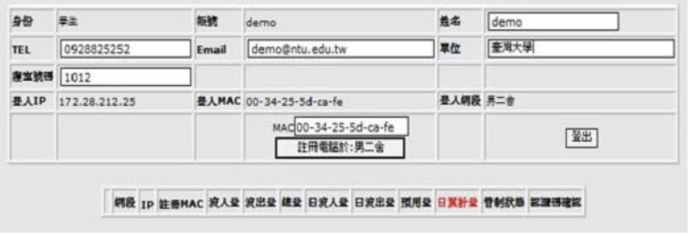
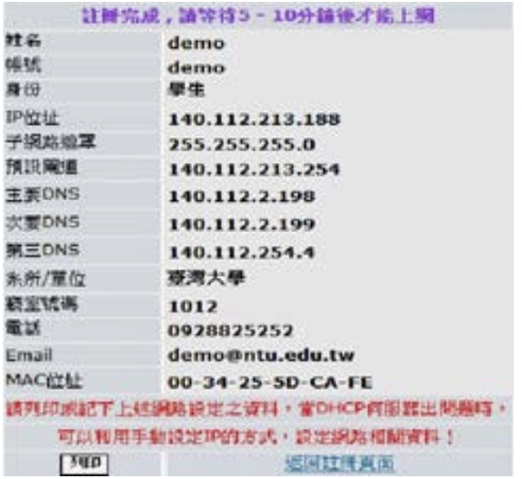
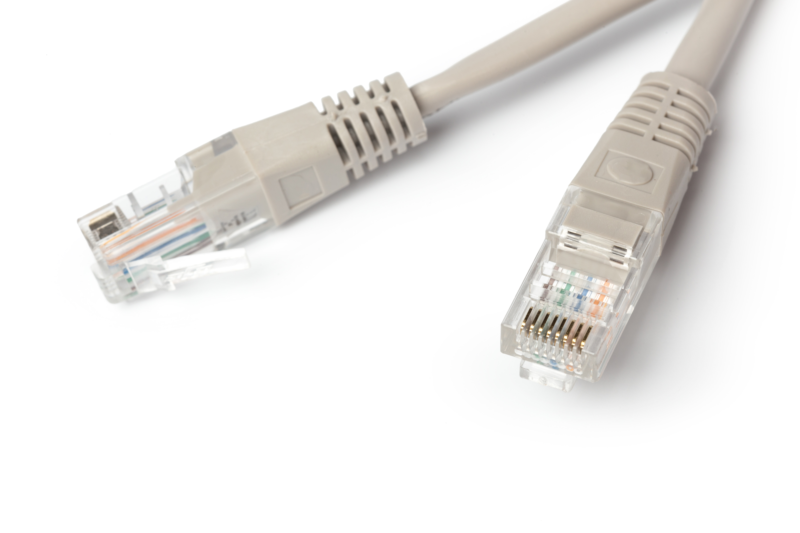
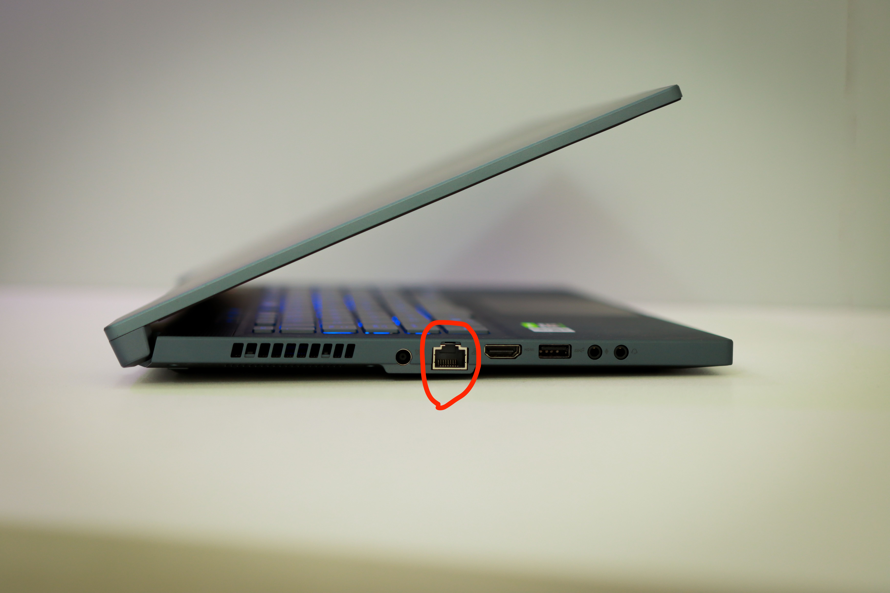
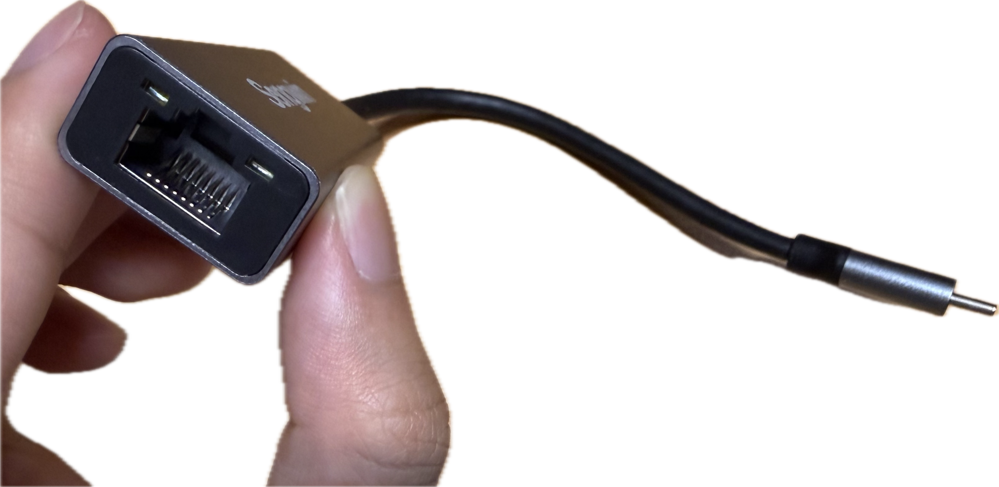

# 台大網路註冊教學 (男女舍通用)
在開始之前，請先想好一個問題，你要用無線的方式連接網路？還是用有線的方式連接？
## 註冊方式 （無線）
請準備一台無線分享器以及乙太網線
（請在宿舍房間進行）
將乙太網線的一端插進宿舍的網路孔另一端插進無線分享器的 WAN 網孔（通常在無線分享器的屁屁，請插進顏色跟其他孔不一樣並且寫WAN的）。

將無線分享器的電源插上並開機。

等待其開機後：

將電腦連接到該無線分享器分享的wifi。（請注意，這時候你可能會看到電腦顯示：無網際網路，也就是說你還不能正常使用網路，這是正常的。請繼續進行下一步）

請打開瀏覽器輸入 `https://dorm.ntu.edu.tw/register/index.php `

你會看到計中的登入頁面，登入。
登入後你會看到以下畫面：

點選「註冊電腦於：男/女x舍」
接下來就會看到這個畫面，代表成功，等待5~10分鐘就可以上網。

## 註冊方式 （有線）
### 事前準備

如果你的電腦沒有

這種孔的話，
請購買轉接頭，大概會長這樣：

### 開始註冊
（請在宿舍房間進行）
將乙太網線的一端插進宿舍的網路孔另一端插進你的電腦或是透過轉接頭插入到你的電腦。（請注意，這時候你可能會看到電腦顯示：無網際網路，也就是說你還不能正常使用網路，這是正常的。請繼續進行下一步）

請打開瀏覽器輸入 `https://dorm.ntu.edu.tw/register/index.php `

你會看到計中的登入頁面，登入。
登入後你會看到以下畫面：

點選「註冊電腦於：男/女x舍」
接下來就會看到這個畫面，代表成功，等待5~10分鐘就可以上網。

## 常見問題：
### 以太網線拔不出來怎麼辦？
請輕壓以太網線凸起的地方，拉出來即可。
### 如果在註冊頁面註冊的時候顯示「MAC 位置重複」怎麼辦？
如果是用無線分享器，可以登入無線分享器的管理頁面，更改MAC address
如果是使用轉接頭連接到電腦，可以嘗試修改MAC address，不過也有可能沒辦法更改成功。請向輔導員借用無線分享器或是買新的轉接頭。（通常比較便宜的轉接頭會無法修改MAC address並且容易撞到MAC address）
如果是直接將以太網線連到電腦，同樣可以嘗試修改MAC address(如果您的電腦是windows 11的話，請在電腦搜尋「裝置管理員」，點開「網路介面卡」 > realtek ... > 進階 > 網路卡位置 > 值 )
### 換宿舍後，無法重新註冊網路
請聯繫網管協助您刪除在舊宿舍的資料，刪除後即可重新註冊。
### 有線網路斷斷續續的怎麼辦？
有線網路對碰觸比較敏感，如果是這種情況的話，請嘗試重新插拔以太網線。
如果碰觸的問題很煩的話可以考慮換成無線的分享器。
如果沒有碰到，還是很常斷斷續續的話，請與網管聯繫。
### 有時候網路很慢怎麼辦？
有可能是用太多網路被限流了，可以到 `http://140.112.2.249/ntu-quota.php`查詢自己的ip的流量。 （自己的ip可以在電腦的網路介面或是註冊網路的頁面找到或是查詢ip的網頁）
相關規定可以參考：https://ccnet.ntu.edu.tw/ccnet/dorm.php
### 為什麼網路突然被限制，甚至完全不能使用？
除了流量超額，也可能是電腦被列入違規主機名單。如果不確定是不是的話，請聯繫網管。
### 無線網路相關設定資訊（一般來說不需要特別處理）
針對宿舍網路，請使用路由模式（routing mode）
IP取得請使用dhcp auto
### 有線網路相關設定資訊（一般來說不需要特別處理）
IP取得請使用dhcp auto
### MAC address是什麼？
他是網路硬體的身分證，一般來說，如果照著上面的教學步驟做的話，系統會自動偵測你的MAC address，因此不需要特別設定。
### 換了電腦、網路卡或轉接頭，需要重新註冊嗎？
- 換轉接頭：需要
- 換電腦：可能需要（如果是用轉接頭連接的話不用）
- 換 Wi-Fi Router：可能需要重新註冊。
- 更換網路線：不需要重新註冊。
### 忘記路由器管理頁面的帳號密碼怎麼辦？
找找看路由器底部標籤。

如果忘記自己設定的管理密碼，可能需要恢復原廠設定（Factory Reset），但這會清除原本的路由器設定。
### 有其他問題怎麼辦？
請聯繫網管
https://osa_dorm.ntu.edu.tw/AboutUs/NetworkManagementAssistants
或是輔導員。
## 參考資料
https://hackmd.io/@JBWY7SINQ5C32zAOI1PzIg/S1eqgV7oR
https://ccnet.ntu.edu.tw/ccnet/pages/student_dorm_content/doc/register.pdf
